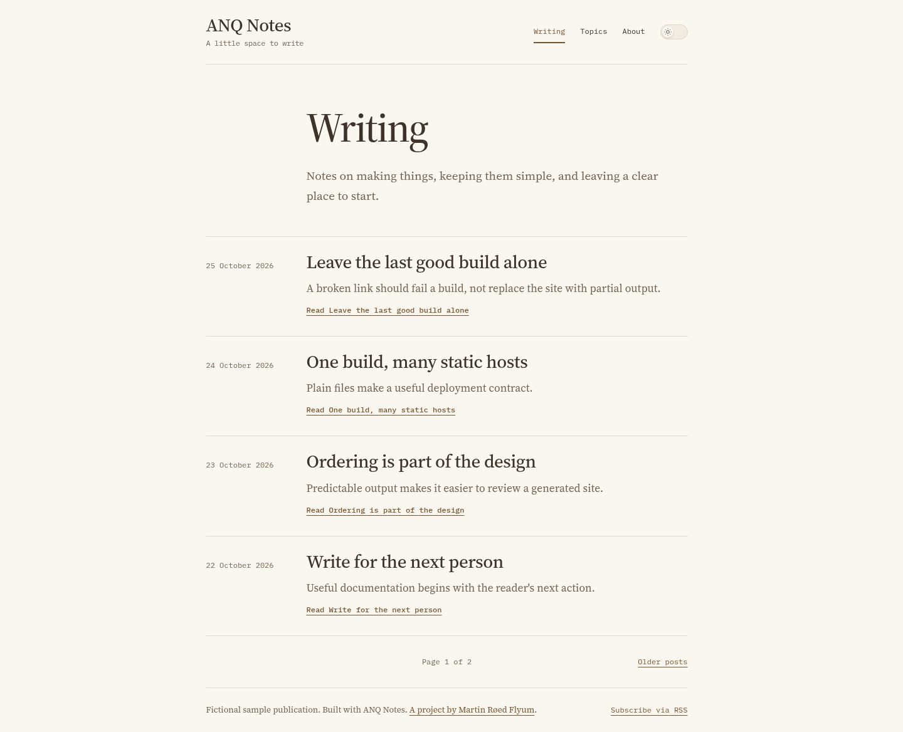

# ANQ Notes

[](https://github.com/adaalrf/anq-notes/actions/workflows/check.yml)

A cloneable TypeScript starter for a small Markdown publication and static pages.
It generates HTML, CSS, topic pages, RSS and a sitemap in `public/`. Visitors need
no JavaScript, account or database. The header stays available while reading,
mobile pages include a return-to-top link, and colours follow the device’s
light/dark preference. An optional appearance switch remembers an explicit choice
in the browser; reading and navigation still work with JavaScript disabled.



## Start locally

Requires Node 24+ and npm. From this directory:

```sh
npm ci
npm run dev
```

Open **http://localhost:5176**. The preview builds once and binds to loopback.
After editing content or styles, run `npm run build` in another terminal and
refresh the browser. `PORT=5177 npm run dev` changes the preview port. Ctrl-C
stops the preview. The preview server is a development tool, not the production
web server.

## Make it yours

1. Edit `site.config.ts`: name, description, author and canonical HTTPS domain.
2. Edit `content/pages/index.md` and the HTML about page.
3. Replace the fictional starter posts in `content/posts/`.
4. Adjust `styles/tokens.css`, then `styles/site.css` for component/layout rules.
5. Run `npm run check` and inspect the output.

The default canonical URL is `https://example.com`; `indexable: false` keeps the
starter out of search indexes. Change both deliberately when preparing an actual
launch. This project does not modify DNS or publish anything itself. URL-prefix
hosting is outside v1: serve the site at a domain/subdomain root.

## Write content

Pages accept `.md` or `.html`; posts accept `.md`. Both start with YAML front
matter. Each lives directly in its folder; nested content folders are unsupported.

```md
---
title: A useful observation
description: A short plain-text description used on cards and in feeds.
date: 2026-10-27
tags: [Notes, Design]
draft: false
---

A paragraph with **emphasis** and a [link](/about/).

## A clear heading

More detail belongs here.
```

`title` and `description` are required. Posts also require a real `YYYY-MM-DD`
date. Pages omit dates and tags. Optional `slug` overrides the filename; use
lowercase letters/digits separated by single hyphens. `index` is the homepage.
Posts render at `/blog/slug/`; other pages render at `/slug/`.

Use `draft: true` to exclude a document from every generated page/feed. Draft
metadata is still validated. Dates control ordering; they do not schedule future
publication. Post order is descending date, then ascending slug for ties. Topics
are ordered by normalized URL slug; conflicting labels produce an error rather
than silently sharing a URL. Keep topic names consistent (for example `Design`).

The layout already provides the page title as h1, so start body sections at h2.
Markdown headings receive unique IDs for fragment links. Internal links must
point to generated URLs, including trailing slashes for page directories. Images
need alt text (or `alt=""` for decoration). Put local images/fonts/files in
`assets/` and link them as `/assets/filename`.

Content HTML is sanitized: scripts, handlers, inline styles and unsafe link
protocols are removed. This supports prose, code, tables, images and semantic HTML
pages. The template, configuration and build source remain trusted project code;
this is not an untrusted-upload service. There is no executable front matter.

## Structure and theme

```text
site.config.ts    Small typed site configuration
content/pages/    Markdown/HTML pages
content/posts/    Markdown posts with YAML metadata
styles/           Shared visual tokens and page/component CSS
templates/        One HTML layout
assets/           Static files copied into output
src/
  pages/          Content page, post, listing, topics and 404 HTML
  components/     Shared headings, post cards and pagination
  build.ts        Filesystem orchestration, routes, feeds and output replacement
  render.ts       Sanitized Markdown, metadata escaping and document layout
  content.ts      Frontmatter parsing and published content ordering
  links.ts        Generated link, fragment and image checks
  config.ts       Typed site configuration validation
  cli.ts          Build entry point
  serve.ts        Local preview server
tests/            Integration, preview, browser and container checks
public/           Generated output; ignored by Git
```

The theme uses the same token names, typography and spacing conventions as ANQ Blog and the
portfolio family. Keep colour/font/spacing roles in `tokens.css`, page structure
in `site.css`, and author prose in `content/`. No UI package, CSS framework,
client bundle or plugin system is needed for v1. Layout placeholders are named
`{{title}}`, `{{siteTitle}}`, `{{description}}`, `{{canonical}}`, `{{language}}`,
`{{author}}`, `{{robots}}` and `{{body}}`; metadata is escaped and body HTML has
already been sanitized. The optional `{{writingCurrent}}`, `{{topicsCurrent}}` and `{{aboutCurrent}}`
placeholders emit trusted current-section attributes for the standard navigation.
Update the layout navigation when adding/removing pages.

## Builds and errors

A build validates metadata, URLs, output collisions, links/fragments, duplicate
IDs and image alt attributes before publishing output. Generated paths, file
ordering and RSS dates are deterministic. RSS includes the latest 20 posts; the
sitemap includes published pages, listings and topics, excluding the 404 page.

An invalid build leaves the previous generated site in place. Successful builds
replace it and remove stale generated routes. `public/` must be absent or contain
this generator's ownership marker; an unknown existing directory is preserved.
Never edit generated output: source files are the durable work.

Builds use a lock, a staging directory and a rename with a previous-output
fallback. This is local build protection, not a production deployment transaction.
If a process crashes, confirm no build is running before removing the stale
`.anq-build.lock`. Inspect leftover `.anq-build-*`/`.anq-previous-*` directories
before recovery; the generator never silently adopts unmanaged output. Source
and asset symlinks are rejected. External URLs are not fetched or checked.

## Verify

```sh
npm run check
npm run test:browser
```

`check` runs formatting, type checking, integration/preview tests and a sample
build. Browser checks need an installed Playwright Chromium; on NixOS set
`CHROMIUM_EXECUTABLE` to a working Nix Chromium binary. They exercise navigation
with JavaScript disabled, posts/topics/pagination, XML feeds, 404, mobile overflow
and automated accessibility scans. Scans are not a complete manual audit.

## Package and publish

Deploy the **contents of `public/`** to a static host. Configure its 404 handler
to serve `404.html` with status 404. No Node process or database is required by
that output.

An optional image follows the existing `anq-publish` static-site contract:

```sh
podman build --build-arg SITE_URL=https://notes.example.com -t localhost/anq-notes:v1 .
npm run test:container
```

The image builds with pinned Node 24 and serves through pinned Caddy as UID 1000
on port 8080. `/healthz` returns 200; no app migrations or writable data volume
are needed. The container check uses free loopback port 18087, a read-only
filesystem and writable `/tmp`, drops capabilities, and removes its test container.
The supplied production CSP supports local assets; keep images/fonts local.
Do not deploy the source, credentials, node_modules or development preview server.

See [deployment](docs/DEPLOYMENT.md) for static hosting and container configuration.
Try the [sample publication](https://notes.demo.adaalrf.dev).

`SITE_URL=https://notes.example.com npm run build` overrides the canonical origin
for a release without editing the starter configuration. Containers accept the
same value as a build argument. The existing HTTPS-origin validation applies;
this does not change `indexable` or enable indexing for the fictional demo.

See [contributing and source layout](CONTRIBUTING.md) for development commands, editing locations and verification boundaries.
