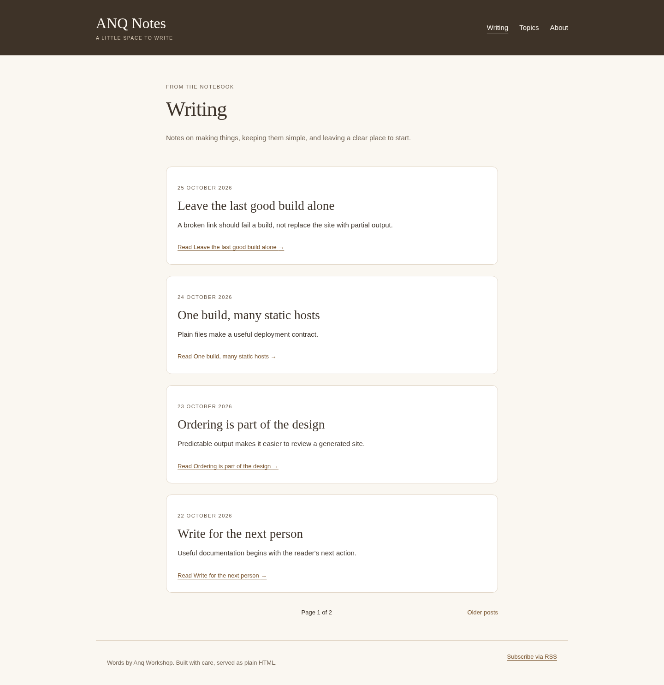

# ANQ Notes: a publication built from plain files

The original generator combined pages, a blog module, themes and a client build.
This clean remake focuses on the author's complete path: edit content, validate,
produce a static publication, and preview it. The original source/history remain
preserved separately. The new implementation is a cloneable source template.

## Architecture

TypeScript functions handle configuration, content parsing, rendering, link
validation and build orchestration. YAML metadata is validated with Zod; Marked
renders Markdown, sanitize-html removes active content, and htmlparser2 inspects
links and heading IDs. Ordinary CSS and system fonts provide the default theme.
No browser bundle is generated.

The same semantic design-token names as ANQ Blog keep the visual family coherent.
The static site has a reading layout rather than the app's workspace navigation.
Changing colour, type or spacing starts in one file.

## Concrete decisions

- Dates are strict calendar dates, not locale-dependent strings. Posts sort by
  date and slug, and generated feed dates derive from content rather than the
  current clock. Identical inputs produce identical file contents.
- Drafts are excluded from pages, topic indexes, RSS and sitemap. Dates do not
  silently schedule publishing.
- A build prepares output and validates links before replacing the owned public
  directory. Invalid content preserves the previous generated site. A lock
  prevents simultaneous writers; staged output and rename fallback keep partial
  writes away from public/. This is not a zero-downtime production transaction.
- Unknown output directories, duplicate routes, tag slug collisions and missing
  fragments fail explicitly. Assets and source directories do not follow symlinks.
- HTML pages and Markdown output share sanitization. Project templates/configuration
  remain trusted code. The generator is not a hosted editor for untrusted uploads.
- Production output consists of static files. An optional pinned Node/Caddy image
  builds them and serves as an unprivileged user with no Node runtime in the final
  image and no database.

## Evidence and limits

Integration/preview tests cover ordering, paging, drafts, stale outputs, failed
build preservation, malformed metadata, link validation, sanitization, locks,
symlinks and HTTP behavior. Browser checks navigate with JavaScript disabled,
parse the XML outputs, exercise topics/posts/pagination, and check mobile overflow
and automated accessibility across six views. A separate static-container check
verifies the packaged runtime. Test screenshots show only fictional starter text.

There is no claim of external-link availability, measured build performance,
independent security review, full manual accessibility compliance or real
production operation. v1 intentionally leaves out plugins, a client bundle,
watch/incremental builds and an installable CLI. The next selected portfolio
project takes priority over expanding this scope.
